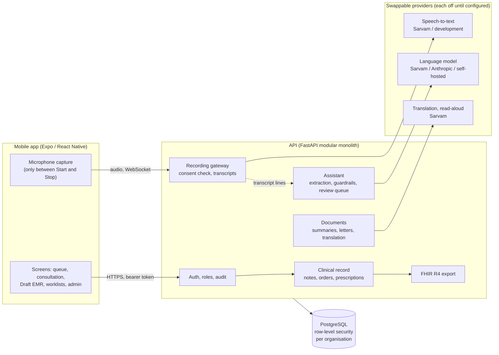
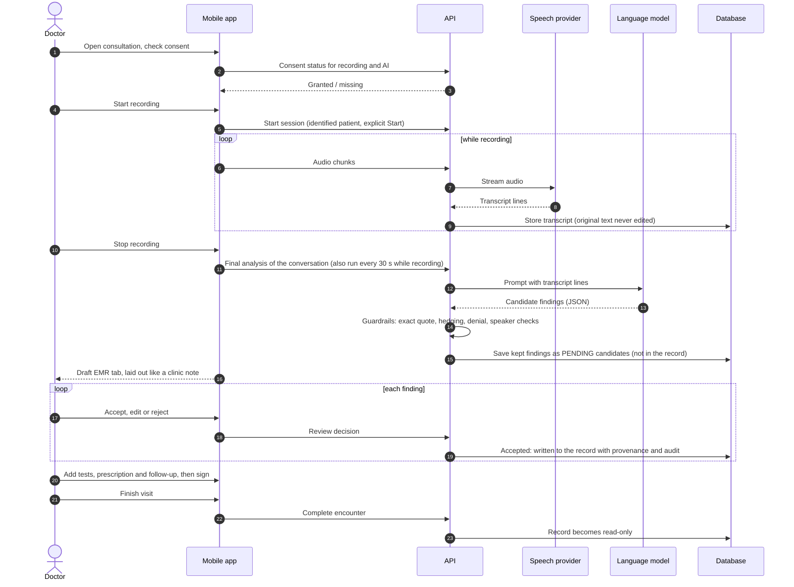
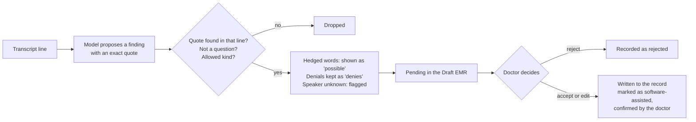

# AarogyaOS

An AI-assisted clinical operating system for Indian clinics and hospitals. It follows a patient from
arrival to follow-up and turns consented, clinician-supervised conversations into structured,
reviewable clinical information.

**AI supports clinicians; it never decides for them.** It does not diagnose, prescribe, order, refer or
discharge. Every workflow works with AI, speech and the network switched off.

> **Status: built and tested, not yet usable with real patients.** The code covers the full workflow, but the
> speech, LLM and microphone integrations have never run against the live services or on a device, no drug or
> terminology database is connected, and nothing has been deployed or reviewed clinically or legally.
> See [What is not done](#what-is-not-done).

## What it does

**Patients and the front desk**
- Register patients with duplicate detection and minimum-necessary search (phone, MRN, name); encrypted ABHA identifier field.
- Appointments, walk-ins, check-in and a live queue per facility and doctor; working hours per practitioner.
- Facilities, departments, practitioners, staff accounts and roles, per organisation.

**The consultation record**
- Nurse triage (vitals with unit conversion, plausibility limits and abnormal/critical flags) then a doctor consultation, in one encounter.
- History, examination, assessment and plan notes; diagnoses with certainty (suspected / provisional / confirmed); allergies and medicine history; follow-ups.
- Investigations: draft, place and record structured results with reference ranges and critical flags.
- Prescriptions: draft, safety check (allergy matching, unknown allergy status, limits of the check stated), acknowledge warnings, sign. Signed prescriptions and reported results are frozen.
- Every fact carries **where it came from** (patient, staff, doctor, device, lab, AI) and **whether a clinician has verified it**. Corrections create a new version; the audit trail is append-only and enforced by the database.
- Note **templates**: built-in and organisation-defined layouts (headings only, never pre-filled).
- **Referral letters** and a visit **summary for the patient**, assembled by code from recorded data, edited and approved by the doctor, then frozen.

**Consent and recording**
- Eight separate consent purposes (recording, transcription, AI processing, audio retention, ...), versioned wording, guardian consent for minors, withdrawal that takes effect immediately.
- Recording only inside an identified, consented session with an explicit Start and Stop; the indicator reflects real microphone and connection state. Audio is discarded by default; retention needs both organisation policy and patient consent.
- Live transcription through a provider-independent speech layer (Sarvam adapter built, a synthetic development provider for testing), with language and code-mixing metadata and speaker roles assigned by a person.

**Clinical AI (optional, reviewed by a clinician)**
- Extracts symptoms, history, medicines, allergies and more from the transcript into a **review queue**, each item quoting the exact words it came from. Nothing enters the record until a clinician accepts, edits or rejects it. Negations and uncertain statements are preserved, not flattened.
- Decision support for the treating doctor: rule-based checks (missing allergy status, abnormal results, allergy clashes) plus model suggestions that must cite approved reference material. Accepting an investigation suggestion creates only a draft order.
- Reference knowledge supplied by the organisation, with two-person approval, versions and retirement.
- **Ask the chart**: ask a question about one patient and get an answer that cites the recorded entries it rests on, or "not found". A plain keyword search over the chart always works, even with AI off.
- Sarvam services (optional, each off until chosen): speech-to-text, translation of patient summaries into the patient's language, reading approved documents aloud, and a Sarvam chat model option.
- Evaluation harness, usage metering, per-organisation switches, and a Claude (Anthropic) adapter alongside a development stand-in.

**Interoperability**
- Read-only FHIR R4 export of a completed visit as a document bundle, with provenance and certainty carried on each resource.

**Platform and operations**
- Strict tenant isolation (PostgreSQL row-level security, tested), backend-enforced roles and permissions, short-lived tokens with rotation and reuse detection, field-level encryption.
- Audit log and event outbox with no clinical content; readiness check that waits for migrations; Prometheus metrics without identifiers; security headers and request limits; scheduled maintenance jobs; encrypted backup and a restore drill; optional pgvector search.

**Administration (mobile, role-gated)**
- Organisation switches (recording, AI, suggestions, audio retention) and patient consent wording; staff accounts and roles; doctor profiles and working hours; note layouts; the reference library (a second administrator must approve a document); speech and AI usage; the audit log.
- Sharing and printing of approved documents and signed prescriptions as PDF, generated on the phone.

**Mobile app (Expo / React Native)**
- Worklists: results awaiting a doctor's review (critical first), follow-ups due (overdue, today, this week), and a lab/radiology order list with result entry for technicians. The result view shows investigations the signed-in doctor ordered, plus those of a colleague who has asked them to cover for up to 31 days. Doctors can also edit a draft prescription before signing it, and pharmacists can look up a patient's signed prescriptions and record whether each was dispensed, partly dispensed or not (no brands, batches or stock). A doctor can hand an open consultation to a colleague at the same site. Before finishing a visit the app lists anything the assistant found that nobody has accepted or rejected (a reported symptom or allergy is not silently left behind), the prescription form offers a plain-words reading of Indian shorthand such as 1-0-1, BD, TDS or HS (it never changes what was typed on its own), and the visit can be copied as plain text for another record system. When an AI-assisted recording ends, the app takes a last look at the conversation and opens a "Draft EMR" tab: the visit laid out like a clinic note (reason for visit, history of present illness, past history, medicines, allergies, family and social history, examination, assessment as said by the doctor, and the plan: tests, treatment, follow-up). Each line shows the words it came from and is accepted, edited or rejected by the doctor; nothing enters the record before that, and a heading with nothing under it means nothing was heard. The assistant also picks out what led to a problem (a fall, an accident), and a follow-up the doctor asked for ("come back after 5 days") can be scheduled in one tap when the time is stated plainly; a vague one stays a plain note.
- Queue and patient context, triage, consultation with tabs for the patient picture, conversation, assist (AI review), notes, diagnoses, tests, prescriptions, follow-up, documents and finish.
- Plain-language states for every failure; clinical writes are never queued offline, so "saved" always means saved.

## How it fits together



The mobile app talks only to the API. Every table carries the organisation it belongs to and the database itself refuses to show one organisation another's rows. The speech, language-model, translation and read-aloud providers sit behind interfaces: the app works with all of them switched off, and a provider that is not configured is simply unavailable. See [docs/ARCHITECTURE.md](docs/ARCHITECTURE.md).

## Consultation flow



Nothing the assistant produces is part of the record until the doctor accepts it, nothing is diagnosed, ordered or prescribed by software, and every step also works by hand if recording, speech or the model is unavailable.

### How a finding is handled



## What is not done

| Area | State |
|---|---|
| Sarvam speech-to-text | Ran live once with a short English clip (16 Oct 2026): connects, accepts the audio and returns final segments. Accuracy on Indian languages, code-mixed speech and drug names is unmeasured |
| Microphone streaming | Written and unit-tested; never run on a device: follow [docs/DEVICE_TEST_PLAN.md](docs/DEVICE_TEST_PLAN.md) |
| Claude LLM adapter | Written and stub-tested; never run against the API. Needs a data-processing agreement and a residency decision first |
| Drug interactions, contraindications, dose checks | Not checked at all (allergy matching is by name only). Needs a licensed drug knowledge provider |
| ICD / SNOMED / LOINC coding | Not built; needs a licensed terminology service |
| ABDM (ABHA, consent manager, health information exchange) | Not built; the FHIR export is base R4, not ABDM profile-conformant. Needs the ABDM guide version and sandbox credentials |
| Sarvam translation, read-aloud and chat | Ran live once (16 Oct 2026, owner's key, via `scripts/sarvam_services_check.py`): all three calls succeeded, and the translation kept its numbers. The spoken audio has not yet been listened to and the Hindi has not been read by a clinician. Translations are drafts a doctor must check. See [docs/SARVAM.md](docs/SARVAM.md) for everything Sarvam is used for, and what is deliberately not |
| Sending letters to other providers | Not built. Documents and prescriptions can be shared or printed as PDF from the phone (untested on a device) |
| Deployment | Not deployed. Docker, Kubernetes, TLS, WAF, managed Postgres, encrypted audio store and Redis (for multi-container audio) are not done |
| Accuracy | AI quality and speech accuracy are unmeasured on real clinical data; the bundled evaluation fixtures are tiny and synthetic |
| Reviews | Clinical safety officer review, CDSCO (SaMD) status, DPDP legal review and a penetration test have not happened |

The full list, with reasons, is in [docs/BACKLOG.md](docs/BACKLOG.md) and [docs/OPERATIONS.md](docs/OPERATIONS.md).

## Repository

| Path | What |
|---|---|
| `apps/mobile` | React Native (Expo Router, TypeScript strict) |
| `services/api` | FastAPI modular monolith, PostgreSQL with row-level security |
| `infrastructure` | Docker Compose, backup and restore-drill scripts |
| `docs` | Architecture, security, clinical safety, operations, ADRs |

## Documentation

| Read | For |
|---|---|
| [docs/ARCHITECTURE.md](docs/ARCHITECTURE.md), [docs/DEVELOPMENT.md](docs/DEVELOPMENT.md) | How it fits together; how to run it |
| [docs/CLINICAL_SAFETY.md](docs/CLINICAL_SAFETY.md) | Hazards (H1-H42), controls and what remains open |
| [docs/AI_ARCHITECTURE.md](docs/AI_ARCHITECTURE.md), [docs/SPEECH_ARCHITECTURE.md](docs/SPEECH_ARCHITECTURE.md) | How AI and speech are kept safe and replaceable |
| [docs/SECURITY.md](docs/SECURITY.md), [docs/DATA_MODEL.md](docs/DATA_MODEL.md), [docs/API.md](docs/API.md) | Security model, data model, endpoints |
| [docs/INTEROPERABILITY.md](docs/INTEROPERABILITY.md) | FHIR export and what ABDM still needs |
| [docs/OPERATIONS.md](docs/OPERATIONS.md), [docs/DEPLOYMENT.md](docs/DEPLOYMENT.md), [docs/DEVICE_TEST_PLAN.md](docs/DEVICE_TEST_PLAN.md) | Running it, backups, scaling limits, device checks |
| [docs/BACKLOG.md](docs/BACKLOG.md), [docs/adr](docs/adr) | What is left and why decisions were made |

## Design

The mobile app's look, what was reviewed and what has not been: [docs/DESIGN_REVIEW.md](docs/DESIGN_REVIEW.md).

## Try it

With Docker Desktop: follow [Try it with Docker Desktop](docs/DEVELOPMENT.md#try-it-with-docker-desktop-windows-mac-or-linux). It starts the database and API, creates a demo clinic with invented users and a patient, and tells you how to point the mobile app at it.

## Quick start

```bash
# API
cd services/api && python -m venv .venv && . .venv/bin/activate && pip install -e ".[dev]"
cp ../../.env.example ../../.env        # fill secrets; the DB role must NOT be a superuser
alembic upgrade head && python -m app.cli seed
uvicorn app.main:create_app --factory --reload

# Mobile
cd apps/mobile && npm install && EXPO_PUBLIC_API_URL=http://10.0.2.2:8000 npx expo start
```

Checks: `ruff check . && ruff format --check . && mypy app && pytest` (API, needs a Postgres superuser URL for the tests) and
`npm run typecheck && npm test` (mobile). Details in [docs/DEVELOPMENT.md](docs/DEVELOPMENT.md).
