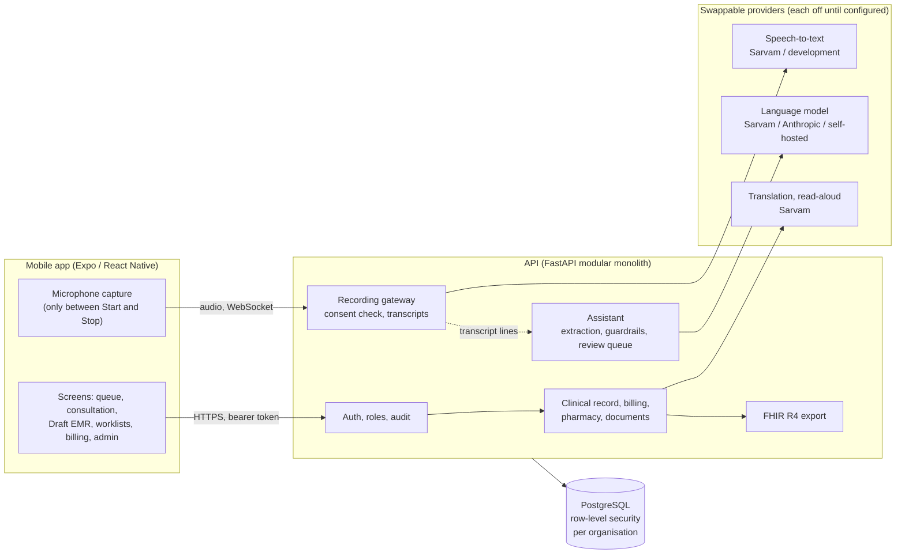
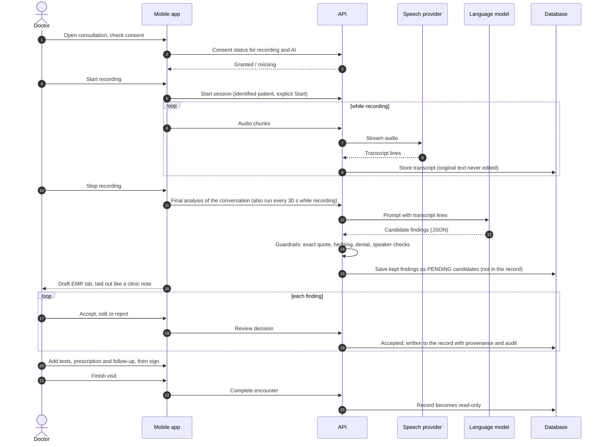
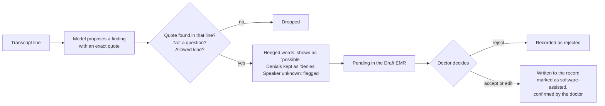

# AarogyaOS

An AI-assisted clinical operating system for Indian clinics and hospitals. It follows a patient from arrival at the front desk through triage, consultation, tests, prescription, pharmacy and billing to follow-up, and it can turn consented, clinician-supervised conversations into structured information that the doctor reviews before anything enters the record.

AI supports clinicians; it never decides for them. It does not diagnose, prescribe, order, refer or discharge, and every workflow also works with AI, speech and the network providers switched off.

> **Status: built and tested, not ready for real patients.** The whole workflow exists and is covered by 516 backend and 276 mobile automated tests, but the speech, language-model and microphone integrations have not been proven on real devices or real clinical audio, nothing has been deployed, and no clinical, legal or security review has taken place. [docs/12-FEATURE-STATUS.md](docs/12-FEATURE-STATUS.md) has the evidence for every claim and [docs/13-PRODUCT-BACKLOG.md](docs/13-PRODUCT-BACKLOG.md) lists what is left.

## What it does

- **Front desk:** patient registration with duplicate detection and minimum-necessary search, appointments, walk-ins, check-in and a live queue.
- **Consultation record:** nurse triage and a doctor consultation in one encounter; vitals, notes, diagnoses with certainty, allergies, medicines, procedures, vaccines, referrals, investigations with results, prescriptions with a safety check and signing, follow-ups. Every fact records where it came from and whether a clinician verified it; corrections add a new version and the database refuses to rewrite history.
- **Consent and recording:** eight separate consent purposes, recording only inside an identified, consented session with an explicit start and stop, live transcription through a provider-independent speech layer (Sarvam adapter built).
- **Clinical AI, optional:** extraction into a review queue where each proposed entry quotes the words it came from, rule-based and cited model suggestions, a reference library with two-person approval, and cited answers to questions about one patient's chart.
- **Documents:** visit summaries and referral letters assembled by code, approved by the doctor, optionally translated and read aloud, shared or printed as PDF.
- **Pharmacy and billing:** dispensing records; invoices with tax lines, payments, credit notes, refunds, a price list, claim tracking and an end-of-day cash count.
- **Platform:** strict tenant isolation in PostgreSQL, backend-enforced roles, short-lived tokens with rotation, optional two-step sign-in, field encryption, an append-only audit log, a tamper-evident seal on signed prescriptions, legal holds, FHIR R4 export of a completed visit, metrics and scheduled jobs.

## How it fits together



The mobile app talks only to the API. Every tenant table carries its organisation and the database itself refuses to show one organisation another's rows. Providers sit behind interfaces; a provider that is not configured is simply unavailable. More in [docs/03-SYSTEM-ARCHITECTURE.md](docs/03-SYSTEM-ARCHITECTURE.md).

## Consultation flow



Nothing the assistant produces is part of the record until the doctor accepts it, nothing is diagnosed, ordered or prescribed by software, and every step also works by hand if recording, speech or the model is unavailable.

### How a finding is handled



## Quick start

Prerequisites: Python 3.12 or newer, PostgreSQL 16, Node 22. Full instructions, including creating the database role, are in [docs/05-INSTALLATION-SETUP.md](docs/05-INSTALLATION-SETUP.md).

```bash
# API (from services/api). The database role must not be a superuser.
python -m venv .venv && . .venv/bin/activate && pip install -e ".[dev]"
cp ../../.env.example .env            # then set AAROGYA_DATABASE_URL
alembic upgrade head && python -m app.cli seed
python -m app.cli demo-seed           # optional: demo clinic with invented users
uvicorn app.main:create_app --factory --reload   # http://localhost:8000/docs

# Mobile (from apps/mobile)
npm install && EXPO_PUBLIC_API_URL=http://10.0.2.2:8000 npx expo start
```

With Docker Desktop instead (the compose stack has not been run in the authoring environment): `docker compose --env-file infrastructure/dev.env -f infrastructure/docker-compose.yml up --build`, then see [docs/05-INSTALLATION-SETUP.md](docs/05-INSTALLATION-SETUP.md).

Checks: `ruff check . && ruff format --check . && mypy app && pytest -q` in `services/api` (needs a PostgreSQL superuser URL in `AAROGYA_TEST_ADMIN_URL`), and `npm run typecheck && npm test` in `apps/mobile`. See [docs/10-TESTING-GUIDE.md](docs/10-TESTING-GUIDE.md).

## What is not done

| Area | State |
|---|---|
| Speech | The Sarvam adapter connected live once with a short English clip. Accuracy on Indian languages, code-mixed speech and drug names is unmeasured |
| Microphone | Written and unit-tested; never run on a device ([docs/DEVICE_TEST_PLAN.md](docs/DEVICE_TEST_PLAN.md)) |
| Claude adapter | Written and stub-tested; never run against the API. Needs a data-processing agreement and a residency decision |
| Drug knowledge | No interaction, contraindication or dose checks; allergy matching is by name only. Needs a licensed source |
| Coding and ABDM | No ICD, SNOMED or LOINC coding; no ABDM integration (paused; needs the implementation guide and sandbox access). The FHIR export is base R4 |
| Tax, payments, claims | Staff enter tax rates, the app does not decide what applies; no payment gateway; claims are tracked, not sent |
| Signatures | A tamper-evident seal exists on signed prescriptions; no legally recognised digital signature |
| Deployment | Nothing deployed. Docker, TLS, WAF, managed database, object store for audio, shared rate limiter and monitoring are not done |
| Reviews | No clinical safety, DPDP/legal, CDSCO or penetration review |

## Repository

| Path | What |
|---|---|
| `apps/mobile` | Expo Router app, TypeScript strict |
| `services/api` | FastAPI modular monolith, Alembic migrations, tests, helper scripts |
| `infrastructure` | Docker Compose, Postgres role setup, backup and restore-drill scripts |
| `site` | One-page marketing site (plain HTML and CSS), see `site/README.md` |
| `docs` | Documentation and decision records |

## Documentation

| Document | Contents |
|---|---|
| [docs/01-PRODUCT-VISION.md](docs/01-PRODUCT-VISION.md), [docs/02-APPLICATION-OVERVIEW.md](docs/02-APPLICATION-OVERVIEW.md) | Purpose, users, principles; roles, journeys, capability map |
| [docs/03-SYSTEM-ARCHITECTURE.md](docs/03-SYSTEM-ARCHITECTURE.md), [docs/04-TECHNICAL-DESIGN.md](docs/04-TECHNICAL-DESIGN.md) | Components, flows, mechanisms and invariants |
| [docs/05-INSTALLATION-SETUP.md](docs/05-INSTALLATION-SETUP.md), [docs/06-CONFIGURATION.md](docs/06-CONFIGURATION.md) | Setup, every environment variable |
| [docs/07-API-DOCUMENTATION.md](docs/07-API-DOCUMENTATION.md), [docs/08-DATABASE-DESIGN.md](docs/08-DATABASE-DESIGN.md) | Endpoints and permissions; tables, rules and migrations |
| [docs/09-DEVELOPMENT-GUIDE.md](docs/09-DEVELOPMENT-GUIDE.md), [docs/10-TESTING-GUIDE.md](docs/10-TESTING-GUIDE.md) | Conventions and how to change things; tests and their gaps |
| [docs/11-DEPLOYMENT-GUIDE.md](docs/11-DEPLOYMENT-GUIDE.md), [docs/OPERATIONS.md](docs/OPERATIONS.md) | Release procedure and target topology; runbook |
| [docs/12-FEATURE-STATUS.md](docs/12-FEATURE-STATUS.md), [docs/13-PRODUCT-BACKLOG.md](docs/13-PRODUCT-BACKLOG.md), [docs/14-ROADMAP.md](docs/14-ROADMAP.md) | What exists, what is left, in what order |
| [docs/15-TROUBLESHOOTING.md](docs/15-TROUBLESHOOTING.md), [docs/16-SECURITY.md](docs/16-SECURITY.md) | Fixes for common problems; security model and gaps |
| [docs/17-BASELINE-AND-RELEASE-GATES.md](docs/17-BASELINE-AND-RELEASE-GATES.md) | What was verified in the November 2026 review, the safeguards added, and what stands between this build and real patients |
| [docs/18-CLINIC-WALKTHROUGH.md](docs/18-CLINIC-WALKTHROUGH.md) | A script for testing the product role by role with an invented patient, from the front desk to the bill |
| [docs/CLINICAL_SAFETY.md](docs/CLINICAL_SAFETY.md) | Hazard log, controls and what remains open |
| [docs/AI_ARCHITECTURE.md](docs/AI_ARCHITECTURE.md), [docs/SPEECH_ARCHITECTURE.md](docs/SPEECH_ARCHITECTURE.md), [docs/SARVAM.md](docs/SARVAM.md) | How AI and speech are kept safe and replaceable |
| [docs/INTEROPERABILITY.md](docs/INTEROPERABILITY.md) | FHIR export and what ABDM still needs |
| [docs/DEVICE_TEST_PLAN.md](docs/DEVICE_TEST_PLAN.md), [docs/DESIGN_REVIEW.md](docs/DESIGN_REVIEW.md), [docs/adr/](docs/adr/) | Device checks, design review, decision records |
