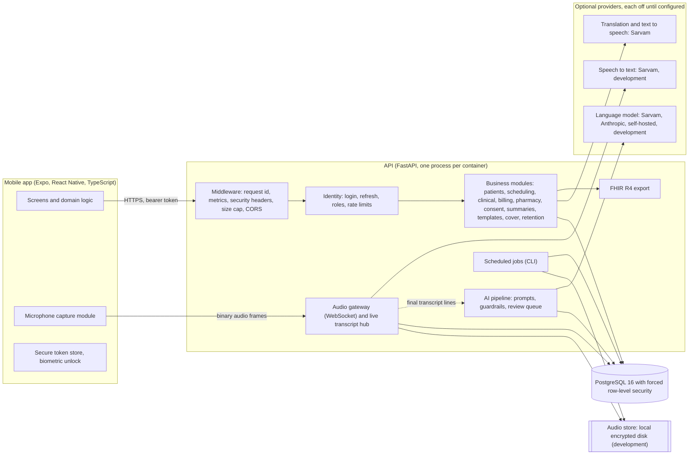
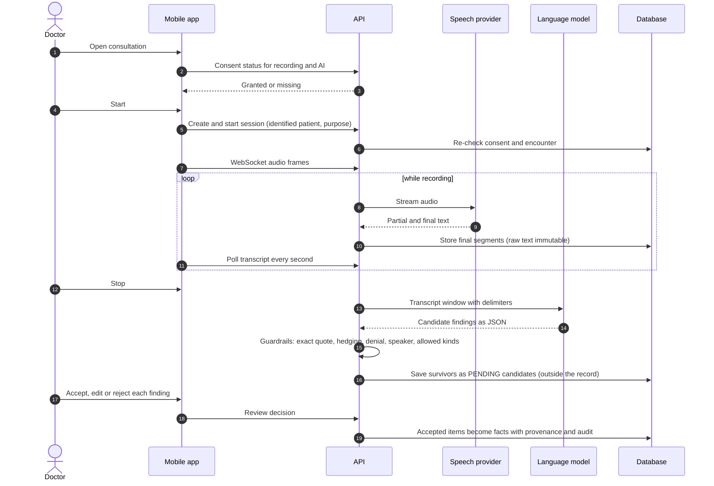

# System architecture

This describes the system as built. It started life as the Phase 0 baseline; the parts of that baseline that turned out differently in the code are corrected here, and what remains planned is marked as planned. Decisions with long-term consequences are recorded individually in `adr/`.

## Overview

AarogyaOS is a two-tier system: a mobile client and a modular-monolith API in front of one PostgreSQL database. Speech, language-model, translation and text-to-speech providers sit behind interfaces and are optional.

The mobile app is the only client. It never talks to a provider directly; all vendor calls leave from the API, which is where consent, minimisation and logging rules are applied.

## Backend structure

`services/api/app` is a single deployable. Modules own their tables and expose service functions; routers are thin and declare the permission each endpoint needs.

| Package | Responsibility |
|---|---|
| `core` | Settings and production rules, database engine and the per-request tenant context, field encryption, password hashing and tokens, error handling, structured logging, metrics, rate limiting |
| `modules/identity`, `tenancy`, `audit` | Users, roles and permissions, refresh tokens, organisations, facilities, departments, the audit log and the event outbox |
| `modules/patients`, `scheduling` | Registration, search, identifiers, appointments, queue |
| `modules/clinical` | Encounters, facts with provenance, prescriptions, orders, results, follow-ups, procedures, vaccines, referrals, prescription seals |
| `modules/consent`, `interactions` | Consent policy and decisions, recording sessions, the audio WebSocket gateway, transcripts, speakers, corrections, audio retention |
| `modules/ai` with `app/ai` | The extraction pipeline, review queue, suggestions, approved reference knowledge, chart questions, usage metering |
| `modules/summaries`, `templates`, `languages` | Visit summaries and referral letters, note layouts, language catalogue |
| `modules/pharmacy`, `billing`, `cover`, `retention`, `interop`, `ops` | Dispensing, billing, doctor cover, legal holds, FHIR export, job ledger |
| `app/speech` | `SpeechProvider` interface, registry with fallback, Sarvam and development providers, live partial-transcript hub, encrypted audio store |
| `jobs.py`, `cli.py`, `demo_seed.py` | Scheduled jobs with advisory locks, operational commands, demo data |

A module never reads another module's tables directly where a service function exists, with the practical exception of read-only joins for names in lists. The speech and AI packages have no imports from request-handling code, so they could later be extracted into separate services; nothing today requires it (ADR-0001).

## Request path and tenant isolation

Each request passes through middleware (request id, metrics, security headers, size limit), then authentication. The bearer token carries user id, organisation id and session id. A dependency opens a database session and sets two PostgreSQL settings (`app.org_id`, plus a bypass flag used only by jobs and platform operations). Every tenant table has `organisation_id`, `ENABLE` and `FORCE ROW LEVEL SECURITY`, and a policy that compares the row to `app.org_id`. Because the policy is forced, even the table owner is filtered; only a PostgreSQL superuser bypasses it, which is why the application must connect as a non-superuser role (see ADR-0004 and `16-SECURITY.md`). The test suite creates such a role on purpose.

## The clinical record model

Clinical facts (observations, notes, diagnoses, allergies, medicine history, procedures, vaccines, referrals) share a set of provenance columns: source, verification state, who recorded it and when, who verified it, the transcript segments it was derived from, the row it supersedes and whether it is current. A database trigger allows only the bookkeeping columns to change on these rows and refuses deletes, so a correction is always a new row. Signed prescriptions, reported results, approved summaries, issued invoices, consent history, transcript segments, credit notes, refunds and legal holds are protected the same way with their own triggers. The audit log is append-only. These rules live in migrations, which means a bug in application code, or a compromised application account, cannot rewrite history; a PostgreSQL superuser still can, and the runbook says to restrict superuser access.

## Speech and consultation flow

The audio gateway authenticates inside the WebSocket (token in the first message, not the URL), enforces a frame size and session time limit, and re-checks consent and session state on a timer, ending the stream if consent is withdrawn. Final segments are stored; partial text lives in process memory only. Because of that, a recording's WebSocket and its transcript polling must reach the same container, and each container runs one worker (ADR-0011). A shared store such as Redis is the planned fix; no Redis code exists yet, although the Compose file starts a Redis container for that future use.

The mobile client polls for transcript lines rather than using server-sent events, because React Native has no convenient authenticated SSE client (ADR-0007). An SSE endpoint exists for web and tablet clients.

## AI and agents

The AI layer is a pipeline, not an autonomous agent. There is no tool-using agent, no background process that acts on the record and no model that writes to the database. Model output is treated as untrusted input: it must parse as strict JSON, every item must carry an exact quote found in the transcript line it cites, questions are dropped, uncertain wording is downgraded to "possible", denials are kept as denials, and items from a speaker of unknown role are flagged. Accepted candidates are written by ordinary application code with the doctor as author. Decision support suggestions are either rule-based (missing allergy status, abnormal results, allergy clashes) or model-generated and required to cite approved reference passages. Details are in `AI_ARCHITECTURE.md`; speech specifics are in `SPEECH_ARCHITECTURE.md`; the Sarvam services and their data handling are in `SARVAM.md`.

## Interoperability

The operational schema is the source of truth. A mapping layer renders a completed visit as a FHIR R4 document bundle (Patient, Practitioner, Organization, Encounter, Observation, Condition, AllergyIntolerance, MedicationStatement, MedicationRequest, ServiceRequest, Procedure, Immunization and a Composition) with provenance and verification state carried as tags. The tests validate bundles with the `fhir.resources` R4B models. No ABDM or NRCeS profile conformance is claimed; see `INTEROPERABILITY.md`.

## Mobile architecture

The app uses Expo Router routes in `src/app`, feature folders under `src/features`, pure logic in `src/domain` (unit-tested without React), a typed API layer in `src/api` (zod schemas validate every response) and device services in `src/services`. Server state lives in TanStack Query with a zero cache time for lists that contain patient data. There is no global store. Access tokens are kept in the platform secure store, with optional biometric unlock. Clinical writes are never queued offline: a failed save tells the user nothing was saved, so "saved" always means saved.

## Deployment shape

Today the repository supports a development Docker Compose stack (Postgres with pgvector, a one-shot migration service, the API, and an unused Redis) and a Dockerfile for the API. Production deployment is not built. The intended shape is a container image per release, migrations run once as a separate step, a readiness probe that stays unhealthy until the schema matches, scheduled jobs from the same image, TLS and a WAF in front, a managed PostgreSQL in an Indian region and an encrypted object store for any retained audio. See `11-DEPLOYMENT-GUIDE.md` and `OPERATIONS.md`.

## Decisions, limitations and technical debt

| Topic | State |
|---|---|
| Modular monolith, synchronous SQLAlchemy | Chosen deliberately (ADR-0001, ADR-0003). Heavy work such as audio runs in the same process; revisit only with measured need |
| Single worker per container | Required by in-memory live transcript hub and duplicate-connection guard (ADR-0011) |
| Rate limits are per worker | Documented limitation; behind a proxy that hides client addresses all users share one login bucket |
| Audio store is local disk | Production needs an S3-compatible encrypted store with a managed key; not built |
| Redis container present but unused | Placeholder for the shared hub and limiter; remove or implement |
| Roles, not care teams | Any clinician in the organisation can open any patient in it (all access audited); no facility or care-team scoping, no break-glass flow |
| No idempotency keys or cursor pagination | Listed as conventions in the baseline, never implemented; lists are capped (for example 100 invoices) |
| Optimistic concurrency | Implemented for patient updates only (`expected_version`) |
| MFA | Optional per-user TOTP with recovery codes; not required for any role, no QR enrolment |
| Request metadata in logs | Access logs record route templates, not raw paths, so record ids stay out; keep logs in-region anyway |
| Reference ranges | Placeholders that need clinical sign-off, including paediatric ranges |

## Risks carried from the baseline

Hallucinated or over-confident AI output is addressed by candidate-only extraction, quotes and the clinician gate. Mis-heard negation, doses or drug names in Indian languages is addressed by mandatory review but not yet measured, because no real-language evaluation set exists. Recording without valid consent is blocked on the server; the wording itself needs legal review under the DPDP Act. Cross-tenant access is covered by forced row-level security plus explicit tests. Regulatory status (CDSCO software-as-a-medical-device, medical council rules for telemedicine) has not been reviewed. Cost of speech and model usage is metered but unpriced.
