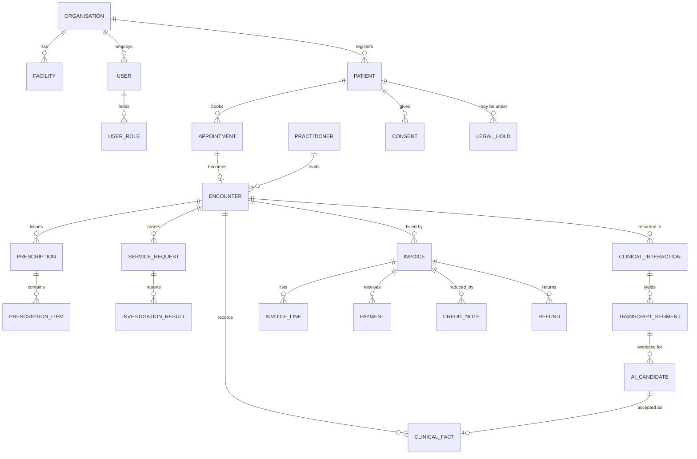

# Database design

The database is PostgreSQL 16. The schema is defined by SQLAlchemy models (one `models.py` per module under `services/api/app/modules`) and created by 15 Alembic migrations in `services/api/alembic/versions`. There are 67 tables. 15 Alembic migrations (0001 to 0015) create them. This document describes the conventions, groups the tables, lists the rules the database itself enforces, and records what each migration added. Table lists below were generated from the model metadata, not copied from older notes.

## Conventions

Primary keys are UUIDs. Every tenant table has a non-null `organisation_id`. Timestamps are `timestamptz` in UTC. Money is whole paise in integer columns. Clinical rows are never overwritten or deleted: a correction inserts a new row that points to the old one with `supersedes_id`. Mobile numbers are stored in E.164 form and are deliberately not unique, since families share numbers. A patient registered by age only has 1 January of the implied birth year stored with `dob_is_estimated = true`.

## Tables by area

| Area | Tables |
|---|---|
| Organisation and access | `organisations`, `facilities`, `departments`, `users`, `roles`, `permissions`, `role_permissions`, `user_roles`, `refresh_tokens` |
| Audit and operations | `audit_logs`, `clinical_events`, `job_runs` |
| Patients | `patients`, `patient_identifiers`, `patient_languages`, `patient_revisions`, `mrn_counters` |
| Scheduling | `practitioners`, `working_hours`, `appointments`, `queue_entries`, `queue_counters` |
| Clinical facts | `encounters`, `observations`, `clinical_notes`, `conditions`, `allergies`, `patient_medications`, `procedure_records`, `immunisations`, `referrals` |
| Orders and prescriptions | `service_requests`, `investigation_results`, `prescriptions`, `prescription_items`, `dispensings`, `follow_ups` |
| Consent and recording | `consent_policies`, `consents`, `clinical_interactions`, `interaction_speakers`, `transcript_segments`, `transcript_corrections`, `audio_assets`, `speech_usage`, `languages` |
| Clinical AI | `ai_extractions`, `ai_candidates`, `ai_suggestions`, `ai_suggestion_actions`, `ai_usage`, `knowledge_documents`, `knowledge_chunks` |
| Documents and layout | `patient_summaries` (visit summaries and referral letters), `note_templates` |
| Cover and holds | `cover_arrangements`, `legal_holds` |
| Billing | `invoices`, `invoice_lines`, `payments`, `invoice_counters`, `credit_notes`, `refunds`, `billing_settings`, `service_prices`, `cash_closings`, `insurance_claims` |

`roles`, `permissions`, `role_permissions` and `languages` are global reference tables (not tenant scoped); everything else carries the organisation.

## Entity relationships

`CLINICAL_FACT` stands for the family of provenance-carrying tables: observations, clinical notes, conditions, allergies, medicine history, procedures, immunisations and referrals.

## Tenant isolation in the database

Every tenant table has row-level security enabled and forced, with a policy named `tenant_isolation` whose predicate is `organisation_id = nullif(current_setting('app.org_id', true), '')::uuid OR current_setting('app.bypass', true) = 'on'`, and the same expression as `WITH CHECK`. The API sets `app.org_id` per request. The bypass flag is used by jobs, seeding and platform operations only. Because the policies are forced they apply to the table owner too. Only a PostgreSQL superuser, or a role with `BYPASSRLS`, ignores them, so the application role must be neither. The test suite deliberately connects as a non-superuser role so the isolation tests mean something (see `tests/conftest.py` and `tests/test_tenant_isolation.py`).

## Rules the database enforces

These are triggers and constraints in the migrations, so they hold even if application code is wrong. The table lists the main ones.

| Rule | Where |
|---|---|
| Clinical facts: only `is_current` and the verification bookkeeping columns may change; no deletes | `guard_clinical_fact` on observations, notes, conditions, allergies, medicine history, procedures, immunisations, referrals |
| Signed or voided prescriptions cannot change (void only); their items are immutable; only drafts can be deleted | `prescriptions_guard`, `prescription_items_guard` |
| Reported results can only gain a review stamp | `investigation_results_guard` |
| Audit log is append-only | `audit_logs_guard` |
| Published consent wording is frozen; consent decisions are append-only apart from withdrawal | `consent_policies_guard`, `consents_guard` |
| Transcript segments and corrections are immutable and append-only | `transcript_segments_guard`, `transcript_corrections_guard` |
| An AI candidate can be reviewed once; reference chunks are immutable | `ai_candidates_final`, `knowledge_chunks_guard` |
| Approved summaries and letters are frozen (they can become superseded) | `patient_summaries_guard` |
| Dispensing records are append-only | `dispensings_guard` |
| Draft invoices are free; an issued invoice, its tax and GSTIN are frozen and can only be voided; only drafts are deletable; lines belong to drafts | `invoices_guard`, `invoice_lines_guard` |
| Payments, credit notes, refunds and cash closings are append-only and attach only to the right invoice state | `payments_guard`, `credit_notes_guard`, `refunds_guard`, `cash_closings_guard` |
| Legal holds can be released once and never edited or deleted | `legal_holds_guard` |
| No two scheduled appointments overlap for a practitioner | `EXCLUDE USING gist` on `appointments` (needs `btree_gist`) |
| One live invoice per visit; invoice numbers unique per organisation | partial unique indexes on `invoices` |
| One cash closing per organisation per day; unique credit note numbers; unique service names ignoring case | unique indexes |

A PostgreSQL superuser can disable a trigger; the seal on signed prescriptions (`prescriptions.seal`) exists so that this kind of change is detectable afterwards.

## Sensitive columns

`patient_identifiers` stores ABHA numbers and similar identifiers as AES-256-GCM ciphertext with a key identifier prefix, with the patient and identifier type bound in as authenticated data, plus an HMAC blind index for equality lookup and a masked hint. Unmasking needs a specific permission and is audited. `refresh_tokens` stores hashes only. `users.mfa_secret` holds the authenticator secret encrypted with the field key (the user id is bound in as authenticated data), and `users.mfa_recovery` holds SHA-256 hashes of unused recovery codes. Audio is not in the database: `audio_assets` holds metadata and the storage key, which becomes null when the audio is deleted.

## Migrations

| Revision | Adds |
|---|---|
| 0001 | Organisations, facilities, departments, users, roles and permissions, refresh tokens, audit log, event outbox |
| 0002 | Patients, identifiers, revisions, practitioners, working hours, appointments with the overlap constraint, queue |
| 0003 | Encounters and all clinical facts, prescriptions, orders, results, follow-ups, with immutability triggers |
| 0004 | Languages, consent policies and consents, recording sessions, speakers, transcript segments, audio assets, speech usage |
| 0005 | AI extractions, candidates, suggestions, usage, reference knowledge, patient summaries |
| 0006 | Job ledger; optional pgvector column and index for reference search if the extension is installed |
| 0007 | Note templates; referral letters on the summaries table |
| 0008 | Doctor cover arrangements |
| 0009 | Transcript corrections |
| 0010 | Dispensing records |
| 0011 | Invoices, lines, payments and counters with freeze triggers |
| 0012 | Procedures, immunisations, referrals as clinical facts |
| 0013 | Tax columns, billing settings, price list, credit notes, refunds, cash closings, insurance claims |
| 0014 | Prescription seal column; legal holds |
| 0015 | Two-step sign-in: `users.mfa_last_step` (replay guard) and `users.mfa_recovery` (hashes of unused recovery codes) |

Migrations are run once per release by a separate step, never on container start (ADR-0011), and `/ready` stays unhealthy until the database revision matches the code. Downgrades have not been exercised against populated databases; treat backups as the real rollback.

## Design notes

The brief for the speech phase had a separate transcripts table; it was folded into `clinical_interactions` plus `transcript_segments` because there is one transcript per session (ADR-0006). FHIR resources are never stored; they are rendered from these tables on demand. Embeddings for reference search are stored as float arrays and ranked in Python unless pgvector is installed (ADR-0009). Codes (ICD, SNOMED, LOINC) are nullable everywhere and are accepted only together with a code system; nothing is coded automatically.
