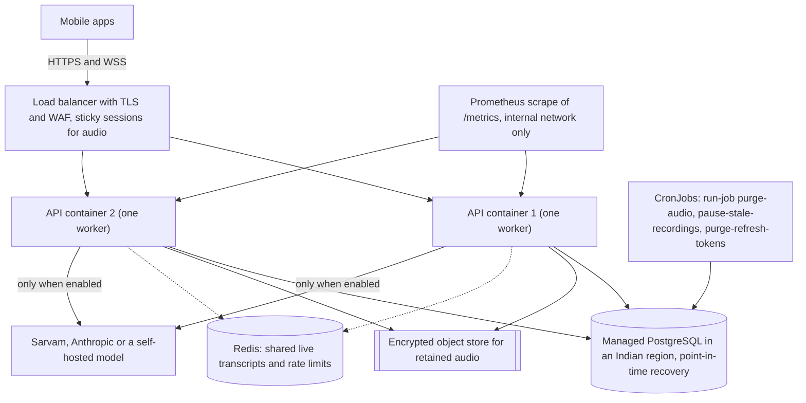

# Deployment guide

**AarogyaOS has not been deployed anywhere, and it is not ready for real patients.** This guide documents what the repository supports today (a container image and a development Docker Compose stack), the procedure a release must follow, the configuration production requires, and what still has to be built before a pilot. The day-two runbook (health checks, metrics, jobs, backups, key rotation, scaling limits) is `OPERATIONS.md` and is not repeated here.

## What the repository provides

| Item | State |
|---|---|
| `services/api/Dockerfile` | Python 3.12 slim image, non-root user, health check on `/health`, one uvicorn worker, no migration on start. Written but never built in the authoring environment, because no Docker daemon was available |
| `infrastructure/docker-compose.yml` | Development stack: PostgreSQL 16 with pgvector, a one-shot migration service, the API, and a Redis container that nothing uses yet. Never started in the authoring environment |
| `infrastructure/postgres/init-app-role.sh` | Creates the non-superuser `aarogya_app` role and database on first start |
| `infrastructure/backup/backup.sh`, `restore-drill.sh` | Encrypted, checksummed `pg_dump`; restore into a scratch database and verify. Run by hand against a development database |
| `.github/workflows/ci.yml` | Tests, lint, types, dependency audit and an Android bundle export. No image build, no deployment |
| Kubernetes, Terraform, Helm, TLS, WAF, secret-manager integration | Not built |
| Mobile release (EAS builds, store listings) | Not built; the app has been exported as an Android bundle in CI only |

## Release procedure

One release, in order. The same steps apply whatever platform you use.

1. Build the API image from `services/api` and tag it with the release.
2. Back up the database. Run the migration step once, as a separate job with the same image and the application's database role: `python -m alembic upgrade head`, then `python -m app.cli seed`. The seed step copies the permission catalogue into the database and must run on every release, because new permissions are added in code. The compose file's `migrate` service is the model for this. Do not migrate at container start, since several replicas would race (ADR-0011).
3. Roll out the API containers. `GET /ready` returns 503 `migrations_pending` until the schema matches the image, so a rollout that skipped step 2 never receives traffic. Keep one uvicorn worker per container and route a recording's WebSocket and its transcript polling to the same container (sticky sessions).
4. Make sure the scheduled jobs exist (below), then check `/health`, `/ready` and, with the token, `/metrics`.
5. Release the mobile build that matches the API. The API does not version its endpoints beyond `/api/v1`; keep mobile and API changes backward compatible across one release, or roll them out together.

Rollback: restore the previous image and, if a migration must be undone, restore from the backup taken in step 2. Migration downgrades exist in some files but have never been exercised on real data.

## Production configuration

Set `AAROGYA_ENVIRONMENT=production`. The API then refuses to start unless a strong `AAROGYA_JWT_SECRET` (32 or more characters), a real `AAROGYA_FIELD_ENCRYPTION_KEY` (base64 of 32 random bytes; back it up and keep it separate from database backups), a database URL that no longer carries the development password, explicit `AAROGYA_CORS_ORIGINS` (never `*`) and TLS provider URLs are set. Speech, language-model and embedding providers are never defaulted in production: choose them deliberately, and note that the development providers are refused. Set `AAROGYA_METRICS_TOKEN` to enable `/metrics`. The full list is in `06-CONFIGURATION.md`.

The application database role must be neither a superuser nor `BYPASSRLS`. If the hosting provider gives you only an administrator role, create a second, ordinary role for the application and run migrations as the owner.

## Scheduled jobs

Run from cron or a Kubernetes CronJob with the API image. A database advisory lock prevents overlap.

| Command | Purpose | Suggested schedule |
|---|---|---|
| `python -m app.cli run-job purge-audio` | Delete retained audio past its date or after consent withdrawal; skips patients under a legal hold | hourly |
| `python -m app.cli run-job pause-stale-recordings` | Pause recordings whose audio stopped, so none claims to be live | every minute |
| `python -m app.cli run-job purge-refresh-tokens` | Delete refresh tokens 30 or more days past expiry | daily |

## Target topology (not built)

Three pieces of this diagram do not exist in the code: the object store (retained audio uses a local encrypted directory), the Redis-backed hub and limiter (live transcripts, the duplicate-connection guard and rate limits are per process), and sticky routing configuration. Until they exist, run one container, or accept the limits listed in `OPERATIONS.md`.

## In front of the API

Terminate TLS and add a WAF and rate limits. The API sets HSTS in production and `Cache-Control: no-store` on `/api/`. Pass the real client address to the API (`--proxy-headers` is on), otherwise every user shares one login rate-limit bucket. Request bodies larger than `AAROGYA_MAX_REQUEST_BYTES` (5 MB by default) are refused, and audio frames are capped at 64 KiB on the WebSocket. Keep `/metrics` on the internal network.

## Backups and recovery

`infrastructure/backup/backup.sh` writes an encrypted, checksummed dump and refuses to write plaintext; `restore-drill.sh` restores into a scratch database and verifies the checksum, the migration revision, forced row-level security on every tenant table and the immutability triggers. A nightly logical dump gives a recovery point objective of up to a day, which is probably not acceptable for clinical use. Decide targets with the clinical lead and arrange point-in-time recovery. Back up the field encryption key separately, and the audio store if retention is on. Details and open decisions are in `OPERATIONS.md`.

## Before real patients

None of this has been done:

- Data residency in India confirmed for every component, including any AI vendor, and signed data-processing agreements with each, including written confirmation of no training on your data.
- Legal review of consent wording and DPDP obligations; CDSCO software-as-a-medical-device determination; a clinical safety officer review of `CLINICAL_SAFETY.md`.
- A penetration test and a threat model of the audio gateway.
- A restore drill passed in the target environment, and the RPO and RTO agreed.
- The microphone module and the speech provider run on real devices with real Indian-language audio, following `DEVICE_TEST_PLAN.md`.
- An object store for audio, a shared rate limiter and live-transcript store, TLS and a WAF, monitoring and alerting, and an on-call process.

These items are tracked, with owners and acceptance criteria, in `13-PRODUCT-BACKLOG.md`.
