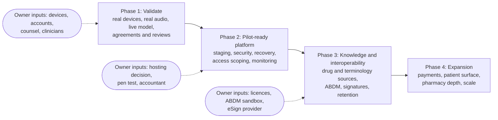

# Roadmap

The roadmap orders the backlog (`13-PRODUCT-BACKLOG.md`) into four phases. It is sequenced by dependency and risk, not by calendar: the repository holds no staffing, budget or date commitments, so none are invented here. Each phase ends with exit criteria that can be checked. Item identifiers refer to the backlog.

## Where the project stands

The application layer is feature complete for a first pilot clinic workflow, and tested against fakes. The unknowns are all at the edges: devices, real speech, a real language model, hosting, and the legal and clinical reviews. That is why the first phase contains almost no new features.

## Phase 1: Validate

Goal: find out whether the riskiest assumptions hold, before more is built on them.

Work: run the microphone module on a low-end Android, a recent Android and an iPhone (A-01); stage clinician conversations in the target languages and measure speech accuracy, including drug names (A-02); run the Anthropic adapter, or the chosen model, live (A-03); settle vendor agreements and residency (A-04); send the consent wording, the hazard log and the regulatory questions to counsel and a clinical safety officer (A-05); walk through every role on devices and fix what is found (A-18); have a neurosurgeon review the note layout (A-45); tidy the first-run configuration friction (B-01, B-02).

Exit criteria: the device test plan's pilot criteria are met; accuracy per language is known and a go or no-go per language is recorded; the live model path works within an agreed cost per analysis; written legal and clinical-safety feedback exists and its actions are logged; no unreviewed vendor receives data.

## Phase 2: Pilot-ready platform

Goal: be able to run one clinic safely and recover from failure.

Work: a staging environment with the image built in CI, TLS, WAF, a managed database with point-in-time recovery and a secret manager (A-06); agreed recovery targets and a passing restore drill (A-08); penetration test and gateway threat model, with fixes (A-07); shared rate limiter and live-transcript hub if more than one container is needed (A-10); object-store audio if any organisation will retain audio (A-11); care-team scoping and break-glass (A-12); sign-off of reference ranges (A-14); monitoring and alerting (A-16); the Expo SDK upgrade (A-17); accountant sign-off on tax (A-19); MFA (A-20); and the engineering hygiene items that make later change safer: contract tests, coverage, migration upgrade tests, screen tests, path-free logs, a dedicated seal key and ownership checks on edits (B-06 to B-09, B-13, B-14).

Exit criteria: staging passes a restore drill and a load test on production-like infrastructure; the penetration test has no open critical or high findings; alerts fire in a failure drill; a clinician can use only the patients they are entitled to, with break-glass audited; CI blocks regressions across API, app and contract.

## Phase 3: Knowledge and interoperability

Goal: add the licensed knowledge and external connections that cannot be built from the repository alone.

Work: a drug knowledge provider for interactions, contraindications and dose checks (A-13); a terminology service for coded diagnoses and medicines (A-31); ABDM integration, including profile-conformant FHIR, HL7 validation and consent artefacts (A-30); a clinician-labelled evaluation set and thresholds (A-15); real embeddings (A-44); a signed vaccine schedule and reminders (A-32); referral letter delivery (A-33); a real digital signature and sealing of other frozen records (A-34, A-35); a records retention schedule and erasure workflow (A-36); result file upload (A-38); idempotency keys and pagination (B-05).

Exit criteria: every safety check states its source and version; coded entries come only from a service; an ABDM sandbox round trip passes; evaluation numbers are published for each AI feature; retention and erasure rules are written down and implemented.

## Phase 4: Expansion

Goal: widen what the product covers once the core is trusted.

Work: payment gateway and insurer claim submission (A-37, A-46); patient-facing surface, which needs its own identity, consent and security review; duplicate merge (A-39); patient photo and push reminders (A-40); pharmacy stock (A-41); further Sarvam capabilities (A-42); dictation mode (A-43); regional-language interface (B-12); capacity work and the admin console (A-47, B-15).

Exit criteria depend on each item; none should start before Phase 2 is complete, because each adds data flows that need the controls Phase 2 establishes.

## Sequencing notes

A-01 and A-02 gate almost everything on the speech side, so start them first and in parallel with the non-engineering reviews in A-04 and A-05, which have long lead times. A-06 should not wait for Phase 1 to finish: the build and deployment work does not depend on the speech results, only the pilot decision does. ABDM (A-30) was paused by the owner; it sits in Phase 3 because it needs outside access and because coded data from A-31 makes it far more useful. Anything that sends data to a third party must wait for A-04.
