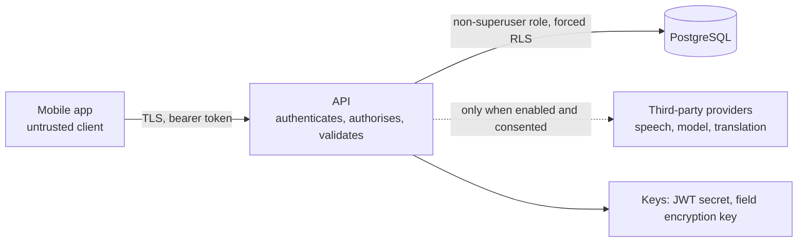

# Security

This document describes the security model as implemented, then lists what is known to be missing. It is a description of controls, not a certification: no penetration test, threat-model review, DPDP legal review or clinical safety sign-off has taken place (`13-PRODUCT-BACKLOG.md`, A-05 and A-07). Hazards with a clinical rather than a security flavour are in `CLINICAL_SAFETY.md`; operations controls (backups, metrics, rotation) are in `OPERATIONS.md`.

## Assets and trust boundaries

The assets that matter are patient identity and clinical content, recorded audio and transcripts, financial records, the keys that protect them, and the integrity of the clinical record. Trust boundaries are the mobile app to the API (untrusted client), the API to PostgreSQL (the database enforces tenancy and immutability in its own right), and the API to third-party providers (speech, language model, translation), which receive health data only when an administrator has switched them on.

## Authentication

Passwords use Argon2id. Access tokens are short-lived JWTs (15 minutes by default) carrying user id, organisation id and session id. Refresh tokens are opaque, stored hashed, rotated on every use, and grouped in families; presenting a token that has already been rotated revokes the family. Accounts lock for 15 minutes after five failed attempts. Login is rate limited per client address. `mfa_enabled` and `mfa_secret` columns exist, but no multi-factor flow is built, and there is no federation with an identity provider (the token interface is kept neutral so one can be added). On the phone, tokens live in the platform secure store, and a biometric unlock can be required to open a stored session. Signing out clears the secure store and every cached query.

## Authorisation

Role-based access control with permissions as strings. The catalogue and the role mapping live in one file and are copied into the database by the `seed` command. Every endpoint declares the permission it needs and the server checks it; the app hiding a button is not a control. Object-level rules sit on top: only an encounter's own doctor writes clinical content to it, transcripts are readable by the recorder and the encounter's doctor, reference documents need a second person to approve, and procedures, vaccines and referrals can be confirmed only by a doctor. Least privilege is deliberate: administrators have no patient permissions; reception has no clinical timeline; billing staff see names, record numbers and amounts but no clinical content; laboratory technicians see only their department's placed orders. Unmasking an identifier needs its own permission and is audited. Every patient open, search (result count only, never the query), timeline view and identifier reveal is audited.

## Tenant isolation

Each tenant row carries `organisation_id`, and PostgreSQL row-level security is enabled and forced with a policy keyed to a per-request setting, so the isolation survives a bug in a query. A superuser or a role with `BYPASSRLS` ignores it, so the application must connect as an ordinary role; the test harness does the same. Cross-tenant tests exist for the API and for direct SQL.

## Data protection

Transport security is expected to be provided in front of the API (TLS, WAF); in production the API sends HSTS and `Cache-Control: no-store` on `/api/`. Sensitive identifiers such as ABHA numbers are encrypted with AES-256-GCM using a subkey derived from `AAROGYA_FIELD_ENCRYPTION_KEY`, with the patient and identifier type bound in as authenticated data; lookup uses an HMAC blind index derived with a separate subkey, so compromise of one does not expose the other. Keys can be rotated (`rotate-field-key`, described in `OPERATIONS.md`); ciphertexts name the key that wrote them. Audio at rest is encrypted per chunk and has no download endpoint. Whole-database encryption at rest is left to the hosting platform, since no hosting exists yet. Secrets come from environment variables; production refuses default secrets.

## Integrity of the record

Clinical facts, signed prescriptions, results, approved summaries, issued invoices, payments, credit notes, refunds, consents, transcripts and the audit log are protected by database triggers (listed in `08-DATABASE-DESIGN.md`), so a defect or a compromised application account cannot rewrite them. A signed prescription additionally carries a keyed-hash seal that exposes direct database edits made by someone who disabled the triggers. The seal is tamper evidence, not a digital signature with legal standing. Administrators can place a legal hold on a patient to stop the audio purge job.

## Consent, recording and audio

Eight separate consent purposes exist; none implies another. History is append-only and records who captured it, the wording version, the language and any representative. The WebSocket accepts the token in its first message only (never in the URL), enforces a five-second authentication deadline, a 64 KiB frame limit, an even frame length and a session time limit, allows one connection per session, and re-checks consent and session state on a timer. Transcript text, vendor error text and audio never appear in logs, audit rows or events (tests assert this). Audio is discarded after transcription unless the organisation policy and the patient's retention consent both allow keeping it.

## Third-party processing and clinical AI

Sending audio or text to a vendor is a disclosure of health data. Before any real provider handles patient data, the organisation needs a signed data-processing agreement, a data-residency decision, written confirmation of no training on its data, and a security review (backlog A-04). Each provider is off unless configured, and production refuses the synthetic ones.

Model output is untrusted input. It is parsed strictly, validated against a schema, and every proposed item needs an exact quote from the transcript line it cites. Transcript text is passed as delimited data, never as instructions, so injected text in a conversation cannot create an ungrounded candidate or a safety suggestion. Reception sessions cannot produce clinical facts, and AI needs its own consent, re-checked on every run. The model receives the transcript window and, for suggestions, coded record items and approved reference passages; the record's names, phone numbers, addresses and identifiers are not sent, although whatever people say aloud in the conversation is, which is one reason AI processing has its own consent. No clinical text appears in logs, events or usage rows.

## Mobile application

Tokens are in the secure store; response data is validated; lists that hold patient data are not cached after use (zero cache time) and the whole cache is cleared on sign-out, with a general 60-second cache time for other queries. The app holds no vendor keys; everything named `EXPO_PUBLIC_*` is public. Clinical writes are never queued offline. Not built: blocking screenshots on sensitive screens, an encrypted offline store (none is needed because nothing is stored offline), and any protection of the clipboard. The "copy visit as text" action deliberately puts clinical text on the clipboard so it can be pasted into another record system, which means other apps may read it (backlog B-17 and B-18).

## Runtime hardening

Security headers on every response; a restrictive content security policy on `/api/`; a request-size cap; production configuration that refuses default secrets, default database passwords and wildcard CORS; metric labels that carry route templates, not identifiers; job failures recorded as an exception class only; backups that refuse to be written unencrypted; a container image that runs as a non-root user.

## Rate limiting

Login is limited per client address and patient search per user (60 a minute each by default; `0` turns a limit off). The limiter lives in each worker's memory, so with several workers the real limit is higher, a restart clears it, and behind a proxy that hides client addresses all users share one login bucket. Accounts also lock after repeated failures and every search is audited. A shared limiter is planned (A-10).

## Financial integrity

Money is integers in paise. Issued invoices, payments, credit notes, refunds and day closings cannot be edited or deleted, and a refund can never exceed money held beyond what is owed. Role separation: reception and billing staff can invoice and take payments; only billing staff and administrators can issue credit notes or refunds or track claims. The application adds up staff-entered tax rates and does not decide what tax applies.

## Audit

`audit_logs` is append-only by trigger and records actor, organisation, action, resource, outcome, address, user agent, correlation id and, for sensitive changes, field names (never clinical text). The event outbox carries identifiers only.

## Known gaps

| Gap | Impact | Backlog |
|---|---|---|
| No penetration test, threat model review or independent code review | Unknown vulnerabilities | A-07 |
| No MFA flow | Weaker authentication for clinical users | A-20 |
| No facility or care-team scoping, no break-glass | Any clinician in an organisation can open any of its patients (audited) | A-12 |
| Per-process rate limits; patient search can enumerate by three-letter prefixes, twenty results at a time, limited only by the rate limit and the audit | Enumeration by an authorised user | A-10 |
| No TLS, WAF or secret manager in the repository; nothing deployed | Production protections are all still to be built | A-06 |
| Audio store is local disk; audio is not re-encrypted on key rotation | Retention is unsafe to enable in production | A-11, B-10 |
| Access logs contain record ids in paths | Logs are sensitive | B-09 |
| No screenshot blocking; clipboard holds clinical text after "copy visit" | Local leakage on the device | B-17, B-18 |
| Seals are keyed from the field encryption key | Rotating without the old key breaks verification | B-13 |
| Edits to procedures and referrals do not re-check encounter ownership | A colleague could alter an entry | B-14 |
| No vulnerability disclosure process or security contact | Researchers have nowhere to report | B-19 |
| `npm audit` reports findings in build tooling (none in the shipped bundle, per the last review) | Supply-chain hygiene | A-17 |
| Database superusers can bypass triggers and row-level security | Restrict and monitor them; never use them for the application | A-06 |

## Regulatory notes (verify with counsel)

These come from law-firm summaries of the Digital Personal Data Protection Rules 2025, notified in November 2025, with most duties phasing in to around May 2027; they must be checked against the gazette. They include verifiable parental consent for children's data with a carve-out for health professionals that needs checking, notice and consent duties that still apply to health data, breach reporting, and consent-manager provisions from November 2026. Also open: CDSCO status of the software as a medical device, medical council rules on recording and telemedicine, and data residency for every component including AI vendors.

## Specialist reviews still needed

DPDP Act compliance; data residency; penetration test; threat model for the audio gateway; key management design (including the seal key); data-processing agreements with each AI provider; clinical safety officer review.
