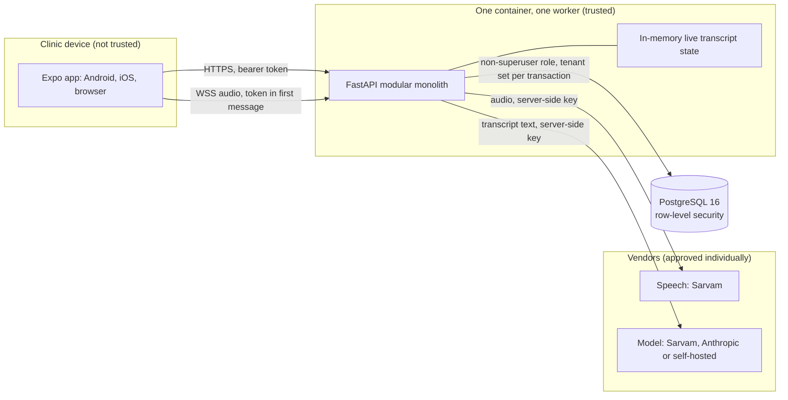
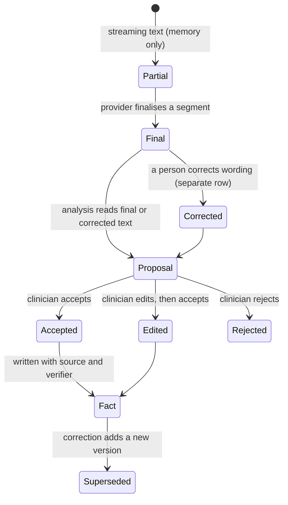
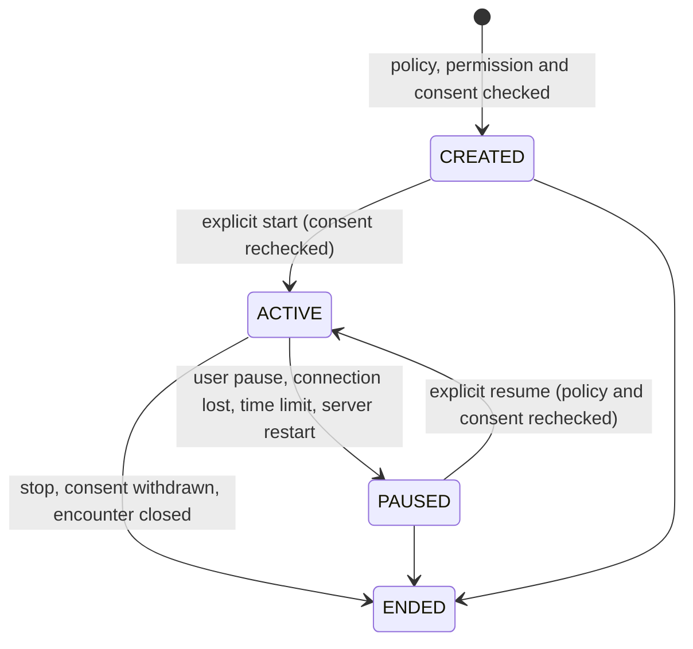

# Baseline, architecture assessment and release gates

This document records a review of the repository as it stood on 13 November 2026, the safeguards added as a result, and what still stands between this build and each stage of use. It was written by reading the code, migrations, configuration and tests, and by running them. Where a statement rests on a test, the test file is named. Where something was not run, it says so.

Three stages are kept apart throughout, because they need different evidence:

1. **Synthetic-data testing.** The build can be installed and exercised end to end with invented patients.
2. **Real patient data.** Vendor agreements, legal review and a security review are in place.
3. **Clinical deployment.** A clinical safety review, device testing and measured speech accuracy are in place as well.

The build is ready for the first stage. It is not ready for the second or third, and nothing in this document should be read as saying otherwise.

## 1. What was verified, and how

Classification: **verified** means there is code and a passing automated test; **partial** means it exists but with a stated gap; **absent** means it is not built; **blocked** means it cannot proceed without something outside engineering.

| Requirement | Status | Evidence |
|---|---|---|
| Registration, appointments, walk-ins, queue | Verified | `test_patients.py`, `test_scheduling.py` |
| Consent per purpose, versioned wording, guardian, withdrawal | Verified | `test_consent.py` (12 tests). Wording is an unreviewed template |
| Triage, vitals, notes, diagnoses, procedures, referrals | Verified | `test_clinical_workflow.py`, `test_history.py` |
| Orders and results, with review and critical-first worklist | Verified | `test_orders_and_followups.py` |
| Prescriptions: draft, allergy check, sign, freeze, seal | Verified | `test_prescriptions.py`, `test_retention.py` |
| Dispensing records | Verified | `test_dispensing.py` |
| Billing, payments, credit notes, refunds, day close | Verified | `test_billing.py`, `test_billing_extras.py` |
| Every workflow usable with speech and AI off | Verified | The manual journey tests above run with no provider; allowance tests in `test_release_gates.py` confirm a note can be written after speech is switched off |
| AI output never enters the record without a clinician's decision | Verified | `test_ai_extraction.py`: analysis "writes nothing to the record"; accept, edit and reject are recorded separately |
| AI extracts what was said and does not act | Verified | `test_ai_guardrails.py` (27 tests): exact-quote evidence, questions are never facts, hedged statements downgraded. A suggested investigation becomes a draft order only |
| Source transcript immutable; corrections a separate layer | Verified | `test_transcript_corrections.py`, including a direct SQL attempt |
| Provenance and verification state on clinical facts | Verified | `test_ai_extraction.py`, `test_clinical_workflow.py` |
| Signed content never silently overwritten | Verified | Database triggers, tested by raw SQL in `test_billing.py`, `test_dispensing.py`, `test_history.py`, `test_orders_and_followups.py` |
| Tenant isolation in services and by row-level security | Verified | `test_tenant_isolation.py`: RLS restricts unfiltered queries, fails closed with no tenant context, blocks cross-tenant writes |
| Tenant context scoped to the transaction (safe with pooling) | Verified | `app/core/db.py` sets it with `set_config(..., true)`, which is transaction-local, on every transaction begin |
| Least-privilege database role | Verified | The test harness connects the application as a non-superuser; `FORCE ROW LEVEL SECURITY` on tenant tables |
| Role matrix enforced on the server | Verified | `test_permissions.py` and per-feature role tests. Platform administrators have no access to tenant data |
| Recording bound to user, organisation, patient, encounter, consent | Verified | `test_interactions.py` (22 tests), `test_gateway.py` (26 tests) |
| No automatic resume after interruption | Verified | Resume is an explicit request that rechecks policy and consent (`interactions/service.py`); a restart now marks recordings interrupted (`test_release_gates.py`) |
| Audit log append-only, without clinical text | Verified | Trigger in migration 0003; `test_audit_and_misc.py`; corrections audited without their text |
| Usage metered per organisation without content | Verified | `test_gateway.py` "usage is metered without content" |
| Organisation limits and alerts on speech and AI use | **Added in this review** | `test_release_gates.py` |
| No patient data to an unapproved provider, including the fallback | **Added in this review** | `test_release_gates.py` |
| Exactly one live instance | **Added in this review** | `test_release_gates.py` |
| Duplicate money requests recorded once | **Added in this review** | `test_release_gates.py`, including four racing requests |
| Audio socket checks the browser's origin | **Added in this review** | `test_release_gates.py` |
| Connectivity shown; nothing queued offline | **Added in this review** | Banner in the app shell; `client.test.ts` |
| Care-team and facility scoping, break-glass access | Absent | Any clinician in an organisation can open any patient there (audited). Backlog A-12 |
| Retention schedule and erasure workflow | Blocked | Needs an approved policy from counsel. Backlog A-36 |
| Drug interaction and dose checks | Blocked | Needs a licensed drug knowledge source. The allergy check is by name and says so |
| Speech accuracy on Indian-language clinical audio | Blocked | No evaluation set exists. Two short live clips only (`SARVAM.md`) |
| Microphone path on a real device | Absent | Never run on a phone. `DEVICE_TEST_PLAN.md` |
| Deployment, TLS, managed database, secret manager | Absent | Nothing is deployed. The Docker image was not built in this review: no Docker daemon was available |
| Shared session coordination for more than one instance | Absent | By design for the pilot; see section 4 |
| Idempotency beyond money (draft invoice, prescriptions, walk-ins) | Partial | Money is covered. Encounter start and recording start were already idempotent |

## 2. Architecture as built

### Components and trust boundaries

The device is never trusted: every permission, tenant boundary and state rule is enforced on the server, and the app hiding a screen is a convenience only. Vendor credentials exist only on the server. Text that comes back from a vendor is treated as untrusted input: model output is parsed against a schema, every proposed entry must quote the transcript exactly, and nothing a model returns can call an endpoint or reach another patient's data.

### The path from speech to record

Partial text lives in process memory and is never stored. Final segments are rows that the database refuses to update. A correction is its own row, attributed and audited without its text. A proposal sits outside the record until a clinician decides, and its decision is kept whichever way it goes.

### Recording lifecycle

Nothing moves a recording from PAUSED to ACTIVE except a person asking for it.

### Roles

The permission catalogue is in `services/api/app/modules/identity/permissions.py` and is the source of truth; `02-APPLICATION-OVERVIEW.md` has the readable table. In summary: reception and billing staff cannot open any clinical record; nurses can triage and record but not diagnose or prescribe; pharmacists see signed prescriptions and record dispensing; technicians see their own department's placed orders; clinic administrators configure the organisation and read the audit log but cannot open a patient record; platform administrators create organisations and can see nothing inside one. There is no administrator bypass. Support access by the platform operator is not designed; if it is ever needed it must be time-limited, attributable and audited, and it does not exist today.

### Failure and deployment behaviour

| Event | What happens |
|---|---|
| Speech provider fails mid-recording | The socket closes with a reason; saved segments stay; the clinician carries on by hand |
| Model returns malformed output | The analysis is recorded as failed; nothing is proposed |
| Network drops on the device | The app shows a banner that nothing is being saved; no write is queued |
| The API process stops | Every active recording is interrupted. On start-up they are marked paused with reason `SERVER_RESTART`. Final segments already saved remain. Text that was only partial is lost |
| A second worker or replica starts | It cannot take the instance lock, reports `standby` on `/ready` and refuses audio connections |
| Planned deployment | Stop the old container, then start the new one. Recordings in progress are interrupted, so deploy outside clinic hours and warn staff |
| Speech or AI allowance used up | New recordings or model calls are refused with an explanation; manual work continues |

### Cost drivers and when to scale

Speech minutes are the dominant variable cost, then model tokens; both are metered per organisation, with cost left empty until a price is configured. The database and a single small container are the fixed cost.

The pilot assumptions (one clinic, about five doctors, 100 to 200 visits a day, a handful of simultaneous recordings) have **not** been tested as a workload. A local run during this review is reported in section 6 and is not a capacity result. Move beyond one instance only when measurement shows one of: sustained CPU above about 70 percent in clinic hours; p95 request latency above about one second; memory growth with concurrent recordings approaching the container limit; database connections near the pool limit; or provider rate limits being reached. Adding instances first requires shared session coordination and a shared rate limiter, built and tested. Redis can hold that shared state, but it does not keep a WebSocket open across a restart.

## 3. What this review added

**Repeated money requests are recorded once.** A phone that sends a payment, loses the reply and sends it again must not record two payments. Payments, credit notes and refunds accept an `Idempotency-Key` header. The key is claimed in the same transaction as the write, so a failed request frees it, and identical requests racing each other queue on a unique index. The key row stores no request or response content. The app sends a key for each intended payment or adjustment and reuses it on retry. Migration 0016; keys older than two days are removed by the `purge-idempotency-keys` job.

**A provider cannot receive patient data until it is approved.** `AAROGYA_PATIENT_DATA_PROVIDERS` lists the vendors with a signed agreement. In production the API refuses to start if any configured provider is missing from it. This includes the speech fallback, which is how an unapproved vendor would otherwise receive audio on the day the approved one failed.

**One live instance is enforced, not assumed.** Each process tries to hold a PostgreSQL advisory lock. The holder is active; any other reports `standby` and refuses audio. This covers both a second worker in one container and a second replica.

**A restart is stated honestly.** Recordings that were active when the process stopped are marked paused on start-up instead of staying marked active until someone opened them.

**Organisations have monthly allowances.** An administrator can cap speech minutes and AI requests. Reaching a cap stops new recordings or model calls and nothing else. Usage and its state (within, near, reached) are shown on the usage screen.

**The audio socket checks where a browser page came from.** A page on another site cannot open a recording socket. Native apps send no origin and are unaffected.

**The app says when it cannot reach the server.** Nothing is queued offline, so a banner states that nothing entered is being saved until the connection returns.

## 4. Decisions made

- **One container, one worker for the pilot.** Live transcript state is in process memory. This is a deliberate availability limit: if the process stops, the service is down until it restarts, and recordings in progress are interrupted. It is acceptable for a single-clinic pilot and must be revisited before more than one clinic depends on the service.
- **Deployments use stop-then-start.** A rolling deployment that waits for the new instance to be ready before stopping the old one will never complete, because the new instance cannot take the lock. This is intended.
- **Allowances count calendar months in UTC** and count every model attempt, including failures, since a failed call may still be charged.
- **No offline clinical writes.** They need a design for local storage protection, synchronisation and conflict resolution on shared devices, which does not exist. Until it does, the app shows connectivity and saves nothing locally.
- **No new infrastructure.** Redis, object storage and a message broker were not introduced. Each has a stated trigger in the backlog.

## 5. Release gates

### Gate 1: synthetic-data testing (met)

Install from a clean checkout, run the test suites, load the demo clinic and walk a visit through every role. Evidence is in section 6.

### Gate 2: real patient data (not met)

Each of these is outstanding and none can be closed by engineering alone:

- A signed data-processing agreement with each vendor, covering the exact APIs and account configuration used: where data is processed and stored, subprocessors and support access, how long audio, transcripts, prompts, outputs, logs and backups are kept, how and when they are deleted, exclusion of patient content from training and service improvement, security responsibilities and incident notification, and permission for clinical documentation use. The intended position is processing and storage in India only, no retention beyond processing, and no training on patient content. Any commitment a vendor will not give is an unresolved blocker. A dashboard setting is not contractual evidence. A vendor being Indian does not by itself establish any of this.
- Legal review of the consent wording, the guardian workflow and the organisation's obligations under the Digital Personal Data Protection Act and Rules.
- An approved retention and erasure policy, reconciled with append-only clinical history and legal holds.
- A deployed environment in an Indian region with TLS, managed PostgreSQL with point-in-time recovery, a secret manager, monitoring and a tested restore.
- An independent security review of that environment, including the audio gateway.
- Care-team scoping and audited break-glass access (backlog A-12), or a written decision to pilot without them.

### Gate 3: clinical deployment (not met)

- Clinical safety review of the hazard log (`CLINICAL_SAFETY.md`) by a clinical safety officer.
- A determination of whether the product is a medical device under Indian rules.
- The microphone path tested on real devices (`DEVICE_TEST_PLAN.md`).
- Speech accuracy measured per language on representative clinical audio, including negation, drug names, numbers and units, with a go or no-go per language.
- Clinician sign-off of vital-sign reference ranges, and a licensed drug knowledge source or a clear statement in the product of what is not checked.

## 6. What was run

Run on 13 November 2026 in a Linux container with four cores, PostgreSQL 16.15 without pgvector, Python 3.12 and Node 22.

| Check | Result |
|---|---|
| `ruff check .`, `ruff format --check .`, `mypy app` | Pass (216 files formatted, 145 source files typed) |
| `pytest -q` (API, real PostgreSQL) | 528 passed, 1 skipped (the pgvector test, which needs the extension) |
| `npm run lint` (app) | 0 errors, 5 warnings, all known and recorded in `DESIGN_REVIEW.md` |
| `npm run typecheck`, `npm test` (app) | Pass; 283 tests in 23 suites |
| `npx expo export --platform android` | Bundle built |
| Migration 0016 on a populated demo database | Applied, downgraded to 0015 and applied again; five patients before and after; the new table has forced row-level security and the application role is not a superuser |
| Two real API processes on one database | The first reported ready; the second reported `standby` with 503 and logged why; when the first stopped the second became ready |
| The app in a headless browser | An administrator set allowances and saw them on the usage screen; an invalid allowance blocked saving; the connection banner appeared when the server was stopped and cleared when it returned |

One defect in an existing test was found and fixed on the way: `test_ready_fails_closed_when_migrations_are_pending` restored the schema version to a fixed, stale revision, so any later readiness check in the same run saw pending migrations. It now restores what it found.

A local load run, for comparison only: `scripts/loadtest.py` with 20 concurrent users for 30 seconds against one worker, with the database and the load generator on the same machine, completed 1,940 requests at about 63 a second. Chart reads, clinical state, vitals and notes had no errors, a median of roughly 0.3 seconds and a 95th percentile of roughly 0.5 seconds; the process held about 200 MB. Most patient searches were refused, as intended, because the script signs every simulated user in as one nurse and the search limit is per user. This says nothing about recordings, AI calls, a real network or production hardware, and it is not a capacity result for the pilot.

Not run: the Docker image build (no Docker daemon), any deployment, the microphone on a device, any live vendor call, a backup restore, a penetration test, and a representative load test.

## 7. Questions for qualified review

These are questions, not conclusions. The summaries of the law below come from secondary sources read in November 2026 and must be confirmed against the official texts.

- **Personal data protection.** The Digital Personal Data Protection Rules, 2025 were notified in November 2025 and are reported to commence in phases, with the main obligations on consent, breach notification and children's data due around May 2027. Which obligations apply to a clinic as data fiduciary and to the software supplier as processor, and from when? Is consent the right basis for each purpose, and is the guardian threshold of 18 correct?
- **Medical device status.** CDSCO is reported to have issued final guidance on medical device software in July 2026, applying the four risk classes of the Medical Devices Rules, 2017. Does software that transcribes a consultation and proposes documentation, without diagnosing or recommending treatment, fall within it, and in which class?
- **Clinical records.** How long must outpatient records, prescriptions and recordings be kept, and how does a patient's request for erasure interact with that?
- **Telemedicine and professional rules.** Do medical council rules on record keeping or telemedicine apply to recorded in-person consultations?
- **Tax.** What must an invoice contain, how are healthcare services treated for GST, and what numbering rules apply?
- **Vendors.** Who is the data fiduciary and who the processor in each vendor relationship, and what must each agreement contain?

Sources read for the two regulatory summaries: [SCC Online on the DPDP Rules, 2025](https://www.scconline.com/blog/post/2025/12/26/digital-personal-data-protection-rules-2025-key-highlights/), [AZB & Partners on the DPDP framework coming into effect](https://www.azbpartners.com/bank/update-indias-digital-personal-data-protection-framework-comes-into-effect/), [Emergo on CDSCO's final guidance](https://www.emergobyul.com/news/india-cdsco-finalizes-guidance-medical-device-software) and [Nishith Desai Associates on the draft guidance](https://nishithdesai.com/research-and-articles/hotline/pharma-healthcare-update/the-next-frontier-in-medtech-regulation-dissecting-cdscos-draft-guidance-on-medical-device-software-15465).
